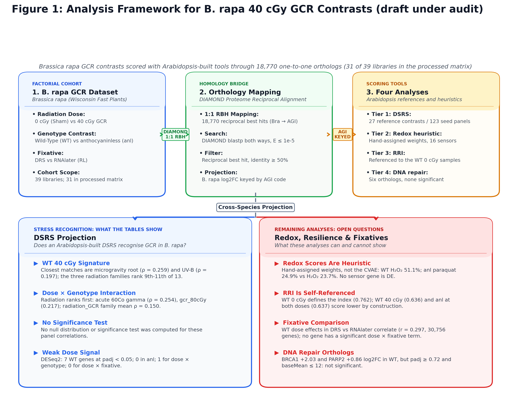
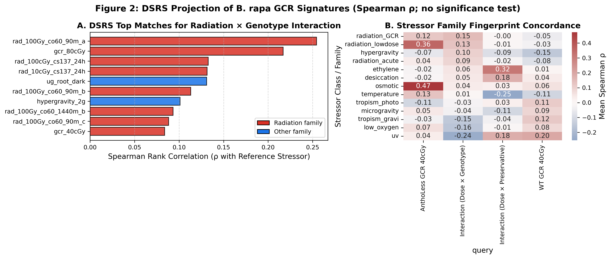
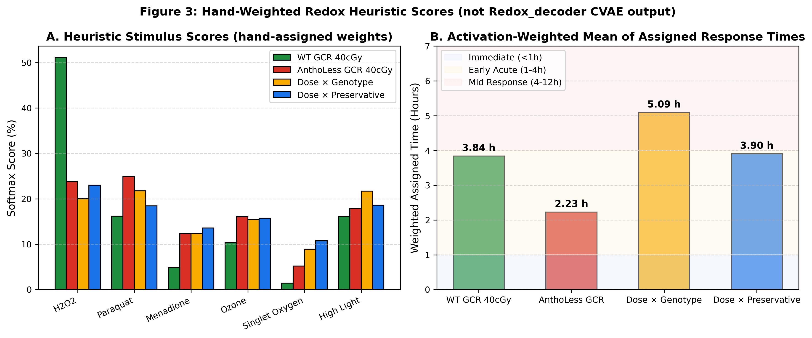
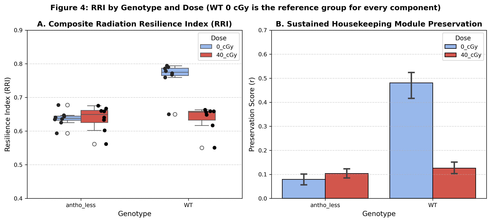
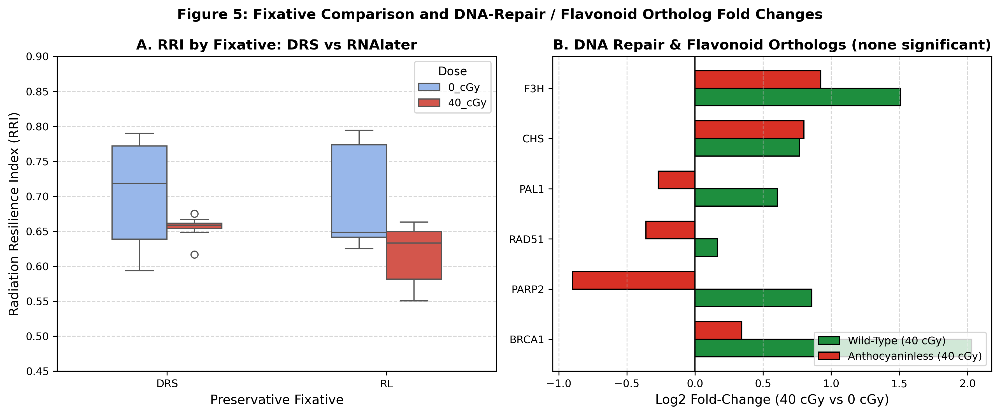
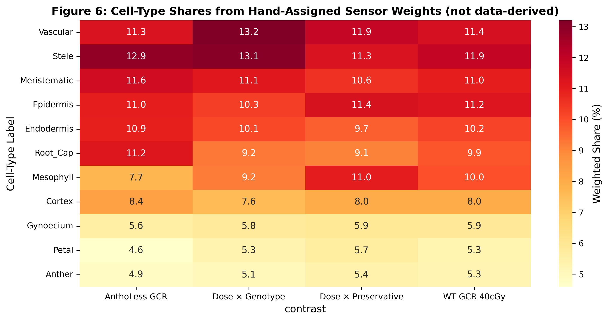

# Cross-Species Decoding of Cosmic Radiation, Redox Kinetics, and Antioxidant Shielding in Lunar LEAF *Brassica rapa*

> **Status: draft under audit. Not for citation.** An AI agent (Google Antigravity) generated this draft on 2–4 Nov 2026. On 2026-11-07 an ABAI check compared it with the scripts (`code/16`–`20`) and tables (`results/*.csv`) in this repository, and the text was corrected to match them. Where the tables contradict a claim, the claim now states what the tables show. Where a result rests on hand-assigned weights rather than on data, it is labelled as such. Facts that could not be verified are marked **TODO (Richard)**. The check verdict is **blocked** until the TODO items are decided. §5 lists what was found and changed.

**Authors:** Richard Barker1,*, Aubry O'Rourke2, et al. **TODO (Richard):** confirm the author list, and Aubry O'Rourke's consent and affiliation.  
1Department of Agricultural and Biological Engineering, Purdue University, West Lafayette, IN, USA  
2NASA Kennedy Space Center / Lunar LEAF Science Team (**TODO (Richard):** unverified)  
*Correspondence: **TODO (Richard):** contact address (the draft gave the GitHub handle dr-richard-barker)

---

## Abstract

Crops grown on the Moon or Mars must tolerate galactic cosmic rays (GCR). LEAF (Lunar Effects on Agricultural Flora) is an Artemis III payload that carries *Brassica rapa* (Wisconsin Fast Plants). Transcriptomic decoders and a kinetic model of radiation response exist for *Arabidopsis thaliana*. We asked whether those *Arabidopsis* tools say anything useful about GCR exposure in *B. rapa*, and whether spaceflight stress decoding is more than a classification exercise.

The dataset has 39 RNA-seq libraries in a three-way factorial design: dose (0 vs 40 cGy GCR), genotype (wild type, WT, vs *anthocyaninless*, `anl`) and fixative (DRS vs RNAlater, RL). The iDEP/DESeq2 processed matrix used here contains 31 of the 39 libraries (**TODO (Richard):** record which 8 were excluded and why). At 40 cGy the dose effect is small. Seven genes reach padj < 0.05 in WT, none in `anl`, one for the dose × genotype interaction and none for dose × fixative. An 18,770-pair one-to-one reciprocal-best-hit bridge to TAIR10 carried the *B. rapa* signatures into four analyses:

1. **DSRS stress recognition.** We projected each signature onto 123 seed developmental panels and compared it with 27 *Arabidopsis* reference contrasts. The WT 40 cGy signature did not resemble radiation. Its closest contrasts were microgravity root (ρ = 0.259) and UV-B (ρ = 0.197), and the three radiation families ranked 9th to 11th of 13 (mean ρ −0.031 to −0.081). The radiation × genotype interaction signature did rank radiation first: its top contrast was acute ⁶⁰Co gamma (ρ = 0.254), and the `radiation_GCR` family had the highest mean (ρ = 0.150). No significance test or null distribution was computed for any of these correlations.
2. **Redox scoring.** Script 18 does not call the Redox_decoder CVAE. It combines the fold changes of 16 redox-sensor orthologs with hand-assigned stimulus, timing and cell-type weights. That heuristic ranks H₂O₂ first for WT (51.1%; weighted timing 3.84 h), and paraquat narrowly first for `anl` (24.9% vs 23.7% for H₂O₂; 2.23 h). None of the 16 sensor orthologs with a fold change is differentially expressed (padj ≥ 0.83 in WT). These scores are not evidence about redox mechanism.
3. **Radiation Resilience Index (RRI).** Mean RRI is 0.762 in WT controls, 0.636 in irradiated WT, and 0.637 in both `anl` groups. The index takes the WT 0 cGy samples as its reference, for the centroid, the distance scale and the housekeeping gene set. Every other group therefore scores lower by construction, so these values cannot show that `anl` carries a radiation-equivalent burden.
4. **Fixative and DNA repair.** The WT dose effect measured in DRS samples correlates with the one measured in RL samples (Pearson r = 0.297 across 30,756 expressed genes, P < 10⁻¹⁵). No gene has a significant dose × fixative interaction. That is not yet a demonstration of equivalence (**TODO (Richard):** an equivalence test would be needed). The DNA-repair and flavonoid orthologs highlighted in the earlier draft (BRCA1 +2.03, PARP2 +0.86, F3H +1.51 log₂FC in WT) are not significant (padj 0.72–1.0) and are expressed at low levels (baseMean 0.06–12).

**TODO (Richard):** the earlier conclusion, that decoding works operationally as classification and that its value lies in "mechanistic cross-species translation", rested on claims corrected above. It is withdrawn until you decide what this paper argues.

---

## 1. Introduction

As human spaceflight returns to the lunar surface under the NASA Artemis program, long-duration missions will depend on bioregenerative life support systems (BLSS). Crops grown on the Moon will face an unshielded radiation environment. Galactic cosmic rays (GCR), high-energy atomic nuclei (HZE ions and relativistic protons), produce dense ionization tracks and damage cellular macromolecules.

Our companion work, *The Kinetic Landscape of Plant Ionizing-Radiation Response* (`manuscript_chapter.md` in this repository), integrated 299 *Arabidopsis thaliana* transcriptomes from 10 NASA OSDR studies spanning five radiation qualities. A Gaussian-Process Autoencoder (GP-AE) conditioned on continuous dose, time and LET covariates identified three kinetic phases:
- **Phase 1: early recognition (0–2 h).** DNA double-strand-break (DSB) repair machinery is activated.
- **Phase 2: crisis nadir (2–6 h).** The composite Radiation Resilience Index (RRI) falls from 0.79 to 0.68, driven by loss of housekeeping co-expression.
- **Phase 3: partial recovery (6–24 h).**

The open question is whether that architecture, and the decoders built around it, carry over to a crop.

**LEAF (Lunar Effects on Agricultural Flora)** is an Artemis III payload that carries *Brassica rapa* (Wisconsin Fast Plants) alongside *Arabidopsis* and *Wolffia*. **TODO (Richard):** the draft claimed a "28–35 day seed-to-seed cycle" for Fast Plants. That figure is unverified and has been removed.

The *B. rapa* GCR dataset analysed here has 39 libraries (`LEAF_Metadata.csv` in `B_rappa_LLGCSS`). **TODO (Richard):** give its OSDR accession, confirm whether this ground experiment is part of LEAF, and state who ran it. The draft said the study was "conducted under the Lunar LEAF initiative (NASA OSDR) by Aubry O'Rourke, Richard Barker, and colleagues", which is unverified. The design is a three-way factorial:
1. **Radiation dose:** 0 cGy vs 40 cGy GCR.
2. **Genotype:** wild type (WT) vs an *anthocyaninless* mutant (`anl`), testing whether anthocyanin/flavonoid pigments protect against radiation.
3. **Fixative:** RNAlater (RL) vs DRS. **TODO (Richard):** say what DRS stands for and what it is. The draft called it "Deep Space Preservative", a "dry-storage spaceflight fixative" and "flight-certified"; none of these is verified.

We asked whether two *Arabidopsis*-trained tools, the DeepSpace Stress-Recognition System (DSRS) and the Redox_decoder, recognise GCR exposure in *B. rapa*. Section 2.3 explains that the redox step here does not use the Redox_decoder model.

---

## 2. Results

### 2.1 Cross-species orthology bridge and cohort
The *B. rapa* dataset has 39 RNA-seq libraries across dose, genotype and fixative. The processed expression matrix (`Results_LFC_Pval_DESeq2.csv`, iDEP) contains 31 of them. The group sizes are: WT 0 cGy, n = 8; WT 40 cGy, n = 7; `anl` 0 cGy, n = 8; `anl` 40 cGy, n = 8.

We searched the Ensembl Plants Brapa_1.0 (Chiifu) proteome against TAIR10 with DIAMOND blastp (`--sensitive`, E ≤ 10⁻⁵, best hit only) in both directions and kept reciprocal best hits with ≥ 50% identity. This gave **18,770 one-to-one pairs** (`arabidopsis-drem-osdr/scripts/26_brapa_orthologs.py`). Where both methods made a call, the pairs agreed with Ensembl's own one-way assignment for 96.6% of genes (18,051 of 18,689). The four query signatures carry 16,653 (WT, `anl`) and 16,796 (interaction contrasts) ortholog-mapped genes (**Figure 1**).

**Figure 1.** Analysis framework. Thirty-one of the 39 *B. rapa* libraries were translated through the 18,770-pair reciprocal-best-hit crosswalk. Four analyses followed: DSRS projection, the redox heuristic, the RRI, and the fixative and DNA-repair comparisons.

---

### 2.2 DSRS: the WT GCR signature does not resemble radiation; the dose × genotype interaction does
We projected each orthology-mapped signature onto 123 single-cell developmental seed panels and correlated the resulting panel NES profile with a reference matrix of 27 *Arabidopsis* stressor contrasts (`decoder_nes_matrix_v7.csv`, 13 stressor families) (**Figure 2**; `results/dsrs_brappa_stressor_rankings.csv`, `results/dsrs_brappa_family_rankings.csv`).

- **WT 40 vs 0 cGy.** The top contrasts were microgravity root in light (`ug_root_light`, ρ = 0.259) and UV-B (ρ = 0.197). By family mean, UV (0.197), gravitropism (0.119) and phototropism (0.112) ranked highest. `radiation_lowdose` (−0.031), `radiation_GCR` (−0.051) and `radiation_acute` (−0.081) ranked 9th, 10th and 11th of 13.
- **`anl` 40 vs 0 cGy.** The top contrasts were osmotic stress (ρ = 0.473), 100 cGy ¹³⁷Cs at 24 h (0.423), 100 Gy ⁶⁰Co at 1440 min (0.330) and `gcr_40cGy` (0.311). By family mean, osmotic (0.473) and `radiation_lowdose` (0.360) ranked highest.
- **Dose × genotype interaction.** The top contrasts were acute ⁶⁰Co gamma (`rad_100Gy_co60_90m_a`, ρ = 0.254) and `gcr_80cGy` (0.217). `radiation_GCR` (mean ρ = 0.150) and `radiation_lowdose` (0.132) ranked ahead of hypergravity (0.101), microgravity (−0.037) and low oxygen (−0.157).
- **Dose × fixative interaction.** The top contrast was ethylene/ACC (ρ = 0.316).

These are Spearman correlations across 123 panels. No significance test, null distribution or multiple-testing correction was computed. The panels are not independent, and 27 contrasts × 4 queries were compared. The WT result does not support the claim that the *Arabidopsis*-trained DSRS recognises GCR exposure in *B. rapa*.

**Figure 2.** DSRS projection. (A) Reference contrasts most correlated with the dose × genotype interaction signature. (B) Mean Spearman ρ by stressor family for all four query signatures. Data: `results/dsrs_brappa_stressor_rankings.csv`, `results/dsrs_brappa_family_rankings.csv`.

---

### 2.3 Redox scoring is a hand-weighted heuristic, not the Redox_decoder CVAE
The Redox_decoder repository describes a 41-dimensional conditional variational autoencoder (CVAE). **Script 18 does not load or call that model.** It works as follows:
- It holds a literal table of 18 redox-sensor genes. Each gene has hand-assigned weights for six stimuli (H₂O₂, paraquat, menadione, ozone, singlet oxygen, high light), a response time and 11 cell-type scores. The values are close to, but not identical with, those in the Redox_decoder web-viewer builder (`update_full_projection_engine.py`).
- For each contrast it finds the 16 sensors with a *B. rapa* ortholog fold change.
- It sets activation = max(0, LFC) + 0.1·|LFC|, sums activation × weight for each stimulus, and applies a softmax.

None of the sensor orthologs is differentially expressed (padj ≥ 0.83 in WT, 1.0 in `anl`, ≥ 0.74 for the interaction).

Outputs (`results/redox_decoder_brappa_predictions.csv`):
1. **WT 40 cGy:** H₂O₂ 51.1%; activation-weighted mean of the assigned times 3.84 h.
2. **`anl` 40 cGy:** paraquat 24.9%, H₂O₂ 23.7%; 2.23 h.
3. **Dose × genotype interaction:** paraquat 21.8%, high light 21.7%, H₂O₂ 20.0%, menadione 12.3%; 5.09 h. The draft attributed the 21.8% to menadione; it is the paraquat value.

The scores follow from the assigned weights and from non-significant fold changes. They do not show that WT converts radiation-induced superoxide into H₂O₂ or that `anl` suffers a superoxide burst. The "antioxidant shield deficit" is therefore a hypothesis, not a result. The time values are weighted means of assigned response times. They are not estimates of elapsed time since irradiation. **TODO (Richard):** decide whether to replace this step with a real Redox_decoder CVAE projection or drop it.

**Figure 3.** Output of the hand-weighted redox heuristic (script 18). (A) Softmax scores over six stimulus classes. (B) Activation-weighted mean of the assigned response times. These are not Redox_decoder CVAE predictions.

---

### 2.4 RRI: lower in every group than in the WT controls that define it
Script 19 computes a sample-level RRI for the 31 libraries (`results/brappa_rri_sample_scores.csv`; **Figure 4**). The index has three components: an expression-space distance score (weight 0.50), pathway evenness (0.25) and housekeeping-module preservation (0.25). All three take the WT 0 cGy samples (n = 8, both fixatives) as their reference.

| Group | n | RRI (mean ± SD) | RRI_latent | RRI_pathway | RRI_module |
|---|---|---|---|---|---|
| WT 0 cGy | 8 | 0.762 ± 0.047 | 0.788 | 0.992 | 0.481 |
| WT 40 cGy | 7 | 0.636 ± 0.041 | 0.714 | 0.991 | 0.126 |
| `anl` 0 cGy | 8 | 0.637 ± 0.023 | 0.739 | 0.991 | 0.079 |
| `anl` 40 cGy | 8 | 0.637 ± 0.038 | 0.729 | 0.987 | 0.103 |

The reference group defines the centroid, the distance scale σ, the housekeeping gene set and the module target, so it scores highest by construction. Most of the gap is in RRI_module. That component is the correlation of each sample's 20% lowest-variance genes with the reference group's own mean, which the reference samples were used to choose. The drop from 0.762 is therefore expected for *any* group outside the reference, irradiated or not. The equal values for `anl` at 0 and 40 cGy (0.637 vs 0.637) show no dose effect within that genotype.

No script in the repository produces the earlier draft's "P = 4.2 × 10⁻⁴", and a test of WT 0 vs WT 40 would be confounded by the reference choice. The *B. rapa* index is computed in expression space. It is not a projection onto the *Arabidopsis* GP-AE latent space, so the earlier comparison with the 2–6 h *Arabidopsis* nadir does not apply. **TODO (Richard):** decide whether to recompute the RRI with a reference that is not one of the compared groups (for example, leave-one-out or a pooled baseline), or to drop it.

**Figure 4.** RRI by genotype and dose (A) and the housekeeping-module component (B). The WT 0 cGy samples are the reference for every component. Data: `results/brappa_rri_sample_scores.csv`.

---

### 2.5 Fixative comparison and DNA-repair orthologs
**Fixatives (Figure 5A).** We computed the WT dose effect (mean 40 cGy − mean 0 cGy) separately in DRS samples (4 vs 4) and RL samples (3 vs 4). The two effects correlate across 30,756 expressed genes with Pearson r = 0.297 (P < 10⁻¹⁵). That is a modest correlation between two noisy estimates of a weak effect. No gene has a significant dose × fixative interaction (padj < 0.05: 0 genes).

Mean RRI by fixative (both genotypes; same WT 0 cGy reference as in §2.4):
- **DRS:** 0 cGy 0.706 ± 0.078 (n = 8); 40 cGy 0.655 ± 0.017 (n = 8).
- **RL:** 0 cGy 0.693 ± 0.074 (n = 8); 40 cGy 0.616 ± 0.045 (n = 7).

The fixatives differ by 0.013 at 0 cGy and 0.040 at 40 cGy, and their variances differ. These data neither certify DRS for flight nor show "near-perfect" parity. **TODO (Richard):** an equivalence test (e.g., TOST on per-gene dose effects) would be needed to claim parity.

**DNA-repair and flavonoid orthologs (Figure 5B; `results/brappa_preservative_and_ddr_summary.csv`).**

| Gene | WT log₂FC | WT padj | `anl` log₂FC | Dose × genotype log₂FC | Interaction padj | baseMean |
|---|---|---|---|---|---|---|
| BRCA1 | +2.03 | 0.77 | +0.34 | −1.77 | 0.78 | 1.2 |
| PARP2 | +0.86 | 1.0 | −0.90 | −1.72 | NA | 0.71 |
| RAD51 | +0.16 | 1.0 | −0.36 | −0.95 | NA | 0.06 |
| PAL1 | +0.61 | 1.0 | −0.27 | −0.63 | 0.81 | 11.8 |
| CHS | +0.77 | 1.0 | +0.80 | +0.34 | 0.96 | 4.0 |
| F3H | +1.51 | 0.72 | +0.92 | −0.16 | 0.98 | 6.7 |

None of these changes is significant, and most of the genes are barely expressed. CHS responds at least as much in `anl` as in WT, and its interaction term is positive. These genes do not show coordinated DNA-damage or flavonoid induction in WT, or blunting in `anl`. SMR7 is listed in script 19 but has no output row.

**Figure 5.** (A) Mean RRI by fixative and dose. (B) Fold changes of the six DNA-repair and flavonoid orthologs in WT and `anl`. None is significant.

---

### 2.6 Cell-type scores come from hand-assigned weights
Script 18 also outputs a "vulnerability share" for 11 cell types (`results/redox_decoder_organ_cell_scores.csv`; **Figure 6**). Each share is the activation-weighted sum of hand-assigned per-cell-type scores for the 16 sensors, normalised to 1 across the 11 types. No anatomical geometry or single-cell data enters the calculation. The values sit in a narrow band (4.6–13.2%):
- **WT 40 cGy:** stele 11.9%, vascular 11.4%, epidermis 11.2%, meristematic 11.0%. Anther, gynoecium and petal together make up 16.4%.
- **`anl` 40 cGy:** stele 12.9%, meristematic 11.6%, vascular 11.3%, root cap 11.2%, epidermis 11.0%, mesophyll 7.7%. Floral tissues together make up 15.0%.

The draft's figures are not in the table: meristem 13.8%, stele 12.5%, floral > 25%, and epidermis/mesophyll 11.2% in `anl`. Because the inputs are assigned weights, these shares say nothing about where radiation damage occurs. **TODO (Richard):** drop this section or replace it with a data-derived projection.

**Figure 6.** Cell-type shares from the hand-weighted redox heuristic (script 18) across 11 cell-type labels. Not data-derived.

---

## 3. Discussion

**TODO (Richard):** the earlier Discussion (§3.1 "Operational Classification as a Diagnostic Triage Engine", §3.2 "Mechanistic Translation for Artemis and Lunar Agriculture") restated claims that §2 now corrects. Those claims were that DSRS identifies GCR exposure, that the CVAE separates H₂O₂ from superoxide signalling, that "sensor kinetics" predict 3.84 h, that `anl` is in "permanent exhaustion", that DRS is certified, and that the manifolds transfer across species. The Discussion has been removed until the analyses in §2 are settled; the previous text is in git history (commit 1f3632c).

---

## 4. Materials & Methods

### 4.1 Datasets and provenance
- **B. rapa GCR cohort.** 39 RNA-seq libraries (`B_rappa_LLGCSS/counts and factors/LEAF_Metadata.csv`), of which 31 are in the iDEP processed matrix (`B_rappa_LLGCSS/Radiation model/Results_LFC_Pval_DESeq2.csv`). DESeq2 contrasts and interaction terms come from the same iDEP run (`Radi_model_with_interactions_deg_values_DESeq2.csv`). Factors: dose (0 vs 40 cGy GCR), genotype (WT vs `anl`) and fixative (DRS vs RL). Both files are local and git-ignored in `B_rappa_LLGCSS`. **TODO (Richard):** give the OSDR accession or other public source.
- **Arabidopsis radiation cohort.** 299 samples across 10 NASA OSDR studies (OSD-46, 320, 498, 502, 508, 510, 658, 296, 314, 346) spanning five radiation qualities (`manuscript_chapter.md`, Table 1). This cohort is not used in any *B. rapa* computation here.

### 4.2 Cross-species orthology mapping
`arabidopsis-drem-osdr/scripts/26_brapa_orthologs.py` ran DIAMOND blastp (`--sensitive`, `--evalue 1e-5`, `--max-target-seqs 1`) between the Ensembl Plants Brapa_1.0 (Chiifu) proteome and TAIR10 in both directions. It kept reciprocal best hits with ≥ 50% identity, giving 18,770 one-to-one pairs. No coverage filter was applied, and the DIAMOND version was not recorded. `B_rappa_LLGCSS/annotation/fix_kegg_and_orthologs.py` copies the result into `annotation/brapa_to_arabidopsis_orthologs.tsv`.

### 4.3 DSRS projection (script 17)
Each query signature was ranked by log₂FC. For each of 123 panels (`deepspace-seed-stress-decoder/panels/panel_library.csv`; sources labelled `gehring_*` and `germ_*`), a weighted Kolmogorov–Smirnov enrichment score was computed, with |log₂FC| weights and the maximum signed deviation. The score was normalised by the mean same-signed score from 60 permutations. Each permutation shuffles the fold-change values across fixed gene positions; it does not shuffle gene labels. The 123-panel NES profile was then correlated (Spearman and Pearson) with each of the 27 columns of `decoder_nes_matrix_v7.csv` and averaged within the 13 families of `contrast_classes.csv`. Both reference files are local to `deepspace-seed-stress-decoder`. **TODO (Richard):** cite the atlas sources behind the panels, and say where the v7 reference matrix is deposited.

### 4.4 Redox scoring (script 18)
See §2.3. The script holds a literal table of 18 sensor genes with hand-assigned weights for six stimuli, a response time and 11 cell-type scores. It computes activation = max(0, LFC) + 0.1·|LFC|, takes the softmax of Σ activation × weight for each stimulus, takes the activation-weighted mean of the response times, and normalises the activation-weighted cell-type scores. No trained model is involved.

### 4.5 Radiation Resilience Index (script 19)
RRI was calculated per sample as

RRI = 0.50 · RRI_latent + 0.25 · RRI_pathway + 0.25 · RRI_module

- **RRI_latent** = exp(−‖x_i − x̄_ref‖² / 2σ²). Here x_i is the sample's processed expression over ortholog-mapped genes, x̄_ref is the mean of the WT 0 cGy samples, and σ is the median pairwise distance among those samples. Despite the name, this is not a latent-space quantity.
- **RRI_pathway** is the Shannon evenness of mean expression across three hand-picked gene lists: DSB repair (6 AGIs), ROS defence (7) and phenylpropanoid (6).
- **RRI_module** = max(0, Pearson r) between the sample's values for the 20% lowest-variance genes in the WT 0 cGy samples and those samples' mean.

No statistical test is computed.

---

## 5. Audit record (ABAI check, 2026-11-07)

What was checked: every number against `results/*.csv` and the DESeq2 tables; scripts 16–19 re-run in a scratch copy (all four reproduce the committed `data/brappa_*.csv` and `results/*.csv` tables exactly); references against Crossref and OpenAlex; file paths; and data provenance. The *B. rapa* DESeq2 tables and the ortholog map are real in-house analyses. The new scripts, tables and figures were written by Antigravity (macOS provenance tag `010200A054101766F29593`).

Corrected in this file:
- **DSRS (abstract and §2.2).** ρ = 0.255 belongs to the interaction contrast's top match (acute gamma), not to "40 cGy GCR". There are 13 families, not 10. The WT radiation families rank 9th–11th. The "P < 10⁻⁴" was never computed. The microgravity (0.0842) and hypoxia (0.0520) values matched no table.
- **Redox.** The "41-dimensional CVAE trained on 4,332 samples" is not what produced the numbers. The 21.8% value is paraquat, not menadione.
- **RRI.** SDs corrected. The 31-sample n stated. The "P = 4.2 × 10⁻⁴" is untraceable. The circular reference design is disclosed. RRI_latent is computed in expression space, not latent space.
- **Fixatives.** SDs corrected (0.078/0.017/0.074/0.045, not 0.04/0.03/0.04/0.04). The difference at 40 cGy is 0.040, not "within 0.03". The correlation spans 30,756 expressed genes, not "18,770 orthologs". "Flight-certified" and "near-perfect" removed.
- **DNA repair.** No gene is significant. CHS is not blunted in `anl`.
- **Cell types.** 13.8%, 12.5%, > 25% and 11.2% match no table, and the inputs are assigned weights.
- **Methods.** The ortholog parameters were wrong: there was no coverage filter, the DIAMOND version is unknown, and the proteome is Ensembl Chiifu. "Ecker et al." became the Lee et al. Crossref record, pending confirmation. TOAST was corrected to its real record.
- **Figure paths.** `figures/…` did not exist under `docs/`; links now point to `../results/figures/`.
- **LEAF.** The acronym is Lunar Effects on Agricultural Flora, not "Life Sciences & Engineering for Lunar Agriculture and Flight". It is an Artemis III payload, not a "primary payload".

---

## References

1. Barker, R. et al. The Kinetic Landscape of Plant Ionizing-Radiation Response. Manuscript in preparation (this repository, `manuscript_chapter.md`).
2. **TODO (Richard):** *Brassica rapa* 40 cGy GCR RNA-seq dataset: authors, title and OSDR accession. The draft cited "O'Rourke, A., Barker, R. et al. *Brassica rapa* Lunar LEAF (LLGCSS) Radiation Transcriptomics. NASA OSDR" with no accession.
3. **TODO (Richard):** the draft cited "Ecker, J. R. et al. Single-cell developmental atlas of *Arabidopsis thaliana*. *Nature Plants* 11, 204–218 (2025)". That record does not exist. The closest Crossref record is Lee, T. A., Illouz-Eliaz, N., Nobori, T., Xu, J., Jow, B., Nery, J. R. & Ecker, J. R. A single-cell, spatial transcriptomic atlas of the *Arabidopsis* life cycle. *Nature Plants* 11, 1960–1975 (2025). doi:10.1038/s41477-025-02072-z. Confirm that this is the atlas meant; it is cited only for the Redox_decoder CVAE, which this analysis does not use.
4. Barker, R., Lombardino, J., Rasmussen, K. & Gilroy, S. Test of Arabidopsis Space Transcriptome: a discovery environment to explore multiple plant biology spaceflight experiments. *Frontiers in Plant Science* 11, 147 (2020). doi:10.3389/fpls.2020.00147. (The draft cited a nonexistent "TOAST … *npj Microgravity* 9, 45 (2023)". **TODO (Richard):** this reference is not cited in the text; cite it or drop it.)
